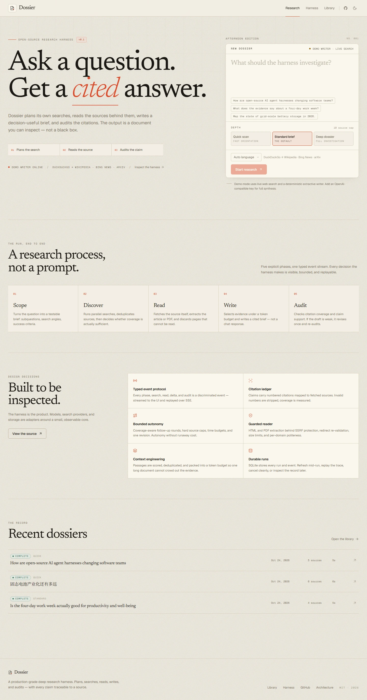
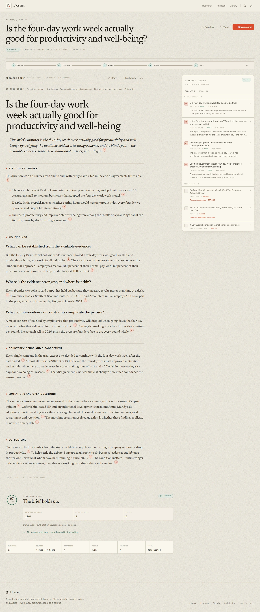
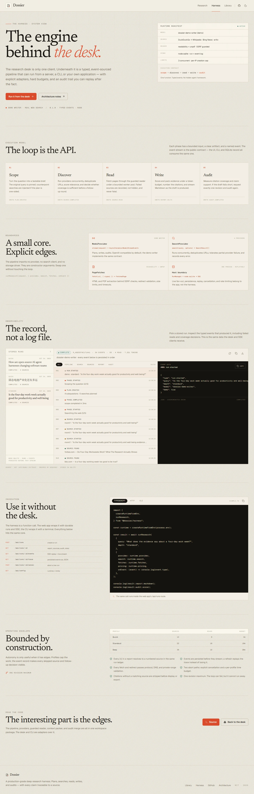
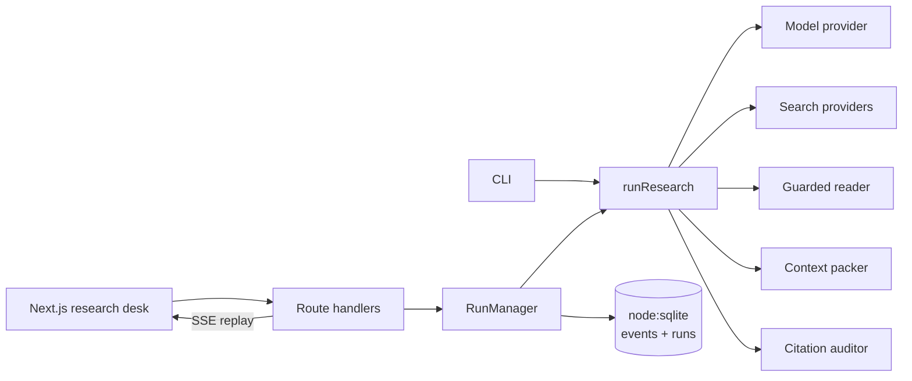

# Dossier

**Deep research, with receipts.**

An open-source deep research harness that plans its own searches, reads the sources, writes a decision-useful brief, and audits every citation — with a typed event stream you can replay, a SQLite record you can inspect, and a web desk built for reading the result.

[](https://github.com/Riddim004/DeepResearch-Agent/actions/workflows/ci.yml)
[](LICENSE)
[](package.json)
[](tsconfig.base.json)



## What this is

Most “deep research” demos are a prompt wrapped around a loop. Dossier is the layer underneath: a small, inspectable harness with explicit phases, bounded autonomy, real source reading, and a citation ledger that can be checked after the fact.

Five phases run in order:

```
scope → discover → read → write → audit
```

- **Scope** turns a question into a research brief: restatement, subquestions, success criteria, and a search plan with counterpoint queries.
- **Discover** runs searches concurrently, deduplicates URLs, scores results, and can add a coverage-driven follow-up round.
- **Read** fetches the actual pages with an SSRF-guarded reader, extracts article text with Readability (or PDF text with unpdf), and discards pages that cannot be read.
- **Write** scores and packs evidence passages under a token budget, numbers the citations, and streams a Markdown brief.
- **Audit** measures citation coverage, checks source support, and requests one revision when the draft falls short.

Everything the harness does emits a typed `HarnessEvent`. The web app stores those events in SQLite and replays them over SSE, so a page refresh mid-run does not lose the trace.

Two surfaces, one core:

- **The desk** (`/`) is the product view: compose a question, watch the run, read the cited brief.
- **The harness console** (`/harness`) is the system view: runtime manifest, pipeline and adapter contracts, budgets, the deterministic benchmark, and a raw typed-event trace you can inspect and download.

The harness itself lives in [`packages/harness`](packages/harness) and has no dependency on Next.js. Both surfaces are adapters over the same `runResearch()` call.

## Highlights

|                          |                                                                                                                                                              |
| ------------------------ | ------------------------------------------------------------------------------------------------------------------------------------------------------------ |
| **Typed event protocol** | Every phase, search, read, report delta, and audit result is a discriminated union event — not unstructured logs.                                            |
| **Bounded autonomy**     | Per-run caps on searches, reads, rounds, time, context tokens, and output size. No runaway loops.                                                            |
| **Citation ledger**      | Claims map to numbered sources; invalid numbers are stripped, coverage is measured, and the source ledger is appended to exports.                            |
| **Real reading**         | Readability + jsdom for HTML, unpdf for PDFs, manual redirect validation, size/time limits, and SSRF protection.                                             |
| **Pluggable by design**  | Swap the model provider, search provider, or page fetcher without touching the pipeline.                                                                     |
| **Durable runs**         | `node:sqlite` persists runs and event logs; interrupted runs are marked, not silently lost; cancellation and timeouts are explicit.                          |
| **Evaluated**            | Seven offline fixture cases — including search/read outages and a forced revision — gate CI on citation coverage, audit score, and S/A/B/C source authority. |
| **Works without a key**  | No model key? A deterministic extractive writer runs against real web sources so the harness, UI, CLI, and tests stay fully usable.                          |
| **Readable by humans**   | An editorial research desk with live field notes, an evidence ledger, a citation audit, a source list, and print/export.                                     |



_One completed run: cited brief, citation audit, source ledger, and the trace of every search and read._



_The harness console at `/harness`: the system view, with a run's typed events and raw JSON payloads._


_The evaluation section: seven fixture cases, citation coverage, graceful-failure handling, and the S/A/B/C authority mix of every cited source. A failing case fails CI._

## Quick start

**Requirements:** Node.js 22.5+ (24 recommended), npm 10+.

```bash
git clone https://github.com/Riddim004/DeepResearch-Agent.git
cd DeepResearch-Agent
npm install
cp .env.example .env
npm run dev
```

Open <http://localhost:3000>. With an empty `OPENAI_API_KEY`, Dossier starts in **demo mode**: real web search and reading, deterministic extractive writing. Add an OpenAI-compatible key to `.env` for model-written briefs. The system view lives at <http://localhost:3000/harness>.

```bash
OPENAI_API_KEY=sk-...
OPENAI_BASE_URL=https://api.openai.com/v1
OPENAI_MODEL=gpt-4.1-mini
```

No search key is required. The default stack uses DuckDuckGo with a free fallback chain (Wikipedia, Bing News RSS, arXiv). Optional Tavily / Brave / Serper / Exa keys upgrade search quality.

### Docker

```bash
cp .env.example .env
docker compose up --build
```

The app is served at <http://localhost:3000>; run data is kept in the `dossier-data` volume.

For production, run the image on a host with a persistent volume and a long-lived Node process. The current store uses SQLite and the API streams long-lived SSE responses, so short-lived serverless functions are a poor fit. Set `SITE_URL` to the public origin for correct Open Graph metadata.

## CLI

The same harness runs headlessly. Progress goes to stderr, the Markdown brief to stdout, so it composes with pipes:

```bash
npm run cli -- "Is the four-day work week actually good for productivity?" --depth quick

# Write a brief, print a JSON run record, or force demo mode
npm run cli -- "固态电池产业化还有多远？" --lang zh --depth deep --out brief.md
npm run --silent cli -- "What is the state of grid-scale storage?" --json > run.json
npm run cli -- "AI coding agents in production" --demo --verbose
```

Use `npm run --silent cli --` when piping stdout (npm otherwise prints its script banner to stdout).

| Flag                                  | Description                           |
| ------------------------------------- | ------------------------------------- |
| `-d, --depth <quick\|standard\|deep>` | Research effort (default `standard`)  |
| `-l, --lang <code>`                   | Output language, e.g. `en`, `zh`      |
| `-a, --audience <text>`               | Describe the intended reader          |
| `-o, --out <file>`                    | Write the Markdown brief to a file    |
| `--json`                              | Print the complete run result as JSON |
| `--demo`                              | Force the deterministic demo writer   |
| `-q, --quiet`                         | Hide progress; emit only the brief    |
| `--verbose`                           | Show searches and every source read   |

Example trace:

```
◆ DOSSIER · evidence-first deep research

  question  Is the four-day work week actually good for productivity and well-being?
  profile   quick · demo writer · real web sources · DuckDuckGo → Wikipedia · Bing News · arXiv

  ────────────────────────────────────────────────────────────
  ✓ Scope      questions and search plan ready  3ms
  ✓ Discovery  3 searches · 8 sources found      986ms
  ✓ Reading    4 read · 2 skipped                1.4s
  ✓ Draft      499 words · 4 citations           1.1s
  ✓ Audit 89/100 · 83% citation coverage · pass

  ● Complete · 3.5s · 4 sources · 4 citations · 4,488 tokens
  brief Markdown written to stdout
```

## Depth profiles

| Profile        | Searches | Sources | Reads | Rounds |    Context | Time budget |
| -------------- | -------: | ------: | ----: | -----: | ---------: | ----------: |
| Quick scan     |        3 |      12 |     6 |      1 |  9k tokens |       4 min |
| Standard brief |        5 |      22 |    10 |      2 | 22k tokens |      10 min |
| Deep dossier   |        8 |      36 |    18 |      3 | 42k tokens |      20 min |

The profile is a ceiling, not a target. Follow-up rounds only run when coverage assessment finds a real gap, and every phase checks the abort signal.

## Configuration

| Variable                                                              | Purpose                                                       |
| --------------------------------------------------------------------- | ------------------------------------------------------------- |
| `OPENAI_API_KEY`                                                      | Enables model-written briefs. Empty ⇒ demo writer.            |
| `OPENAI_BASE_URL`                                                     | OpenAI-compatible endpoint.                                   |
| `OPENAI_MODEL`                                                        | Model name (default `gpt-4.1-mini`).                          |
| `DEEPSEEK_API_KEY`                                                    | Shortcut for `https://api.deepseek.com/v1` + `deepseek-chat`. |
| `SEARCH_PROVIDER`                                                     | `auto`, `duckduckgo`, `tavily`, `brave`, `serper`, or `exa`.  |
| `TAVILY_API_KEY` / `BRAVE_API_KEY` / `SERPER_API_KEY` / `EXA_API_KEY` | Optional search upgrades.                                     |
| `DOSSIER_DEMO`                                                        | Set to `1` to force the demo writer even when a key exists.   |
| `DOSSIER_DATA_DIR`                                                    | SQLite + event log location (default `./.data`).              |
| `SITE_URL` / `NEXT_PUBLIC_SITE_URL`                                   | Public origin used for metadata and Open Graph URLs.          |
| `MODEL_INPUT_USD_PER_1M` / `MODEL_OUTPUT_USD_PER_1M`                  | Optional cost estimation shown in the UI.                     |

The full template lives in [`.env.example`](.env.example).

## HTTP API

The web app is a thin, durable shell around the harness.

| Endpoint                    | Purpose                                                                                       |
| --------------------------- | --------------------------------------------------------------------------------------------- |
| `POST /api/runs`            | Start a run. Body: `{ query, depth?, language?, audience?, recencyDays? }`. Returns `{ id }`. |
| `GET /api/runs/:id`         | Fetch the run record, report, sources, audit, and stats.                                      |
| `GET /api/runs/:id/events`  | SSE event stream. Replays history, then streams live. Supports `after` / `Last-Event-ID`.     |
| `GET /api/runs/:id/trace`   | Persisted typed events as a JSON snapshot, used by the harness console.                       |
| `POST /api/runs/:id/cancel` | Abort a live run cleanly.                                                                     |
| `GET /api/config`           | Public runtime config: demo mode, model, search stack, limits.                                |
| `GET /api/health`           | Liveness and version.                                                                         |

Operational guardrails: three concurrent runs, six run creations per IP per ten minutes, per-run timeouts, and bounded output.

## Using the harness directly

The harness is a workspace package (`@dossier/harness`) exported from TypeScript source. Inside this monorepo:

```ts
import { createRuntimeFromEnv, runResearch, type HarnessEvent } from "@dossier/harness";

const runtime = createRuntimeFromEnv(process.env);

const result = await runResearch(
  { query: "What does the evidence say about a four-day work week?", depth: "standard" },
  {
    provider: runtime.provider,
    search: runtime.search,
    fetcher: runtime.fetcher,
    pricing: runtime.pricing,
    onEvent: (event: HarnessEvent) => console.log(event.type),
  },
);

console.log(result.report.markdown);
console.log(result.audit.score, result.audit.citationCoverage);
```

Custom providers only need the interfaces in [`packages/harness/src/types.ts`](packages/harness/src/types.ts): `ModelProvider`, `SearchProvider`, and `PageFetcher`. See [docs/harness.md](docs/harness.md) for extension points.

## Architecture



| Workspace                              | Responsibility                                                                            |
| -------------------------------------- | ----------------------------------------------------------------------------------------- |
| [`packages/harness`](packages/harness) | Pipeline, providers, search, reader, context packing, citations, audit, runtime assembly. |
| [`apps/web`](apps/web)                 | Next.js desk, API routes, SSE, SQLite store, run manager, UI components.                  |
| [`apps/cli`](apps/cli)                 | Pipe-friendly command line over the same harness.                                         |

Deeper design notes, invariants, and failure modes are in [docs/architecture.md](docs/architecture.md).

## Quality

```bash
npm run typecheck   # strict TS across all workspaces
npm run lint        # ESLint (web)
npm test            # 49 unit tests (harness)
npm run eval        # 7-case deterministic benchmark, exits 1 on regression
npm run build       # production Next.js build
```

The test suite covers the SSE parser, citation transformation, safe-URL/SSRF checks, context budgeting, JSON extraction, search parsing/merging, source tiering, the benchmark runner, and a full fixture pipeline run. CI runs typecheck, lint, tests, evaluation, build, and a Docker build on `main`.

## Evaluation

`npm run eval` executes the real pipeline against a fixed offline corpus and deterministic writer. It measures pass rate, citation coverage, audit score, cited-domain diversity, source authority (S/A/B/C), graceful failure handling, latency, and token usage. The JSON report lands in `evals/latest.json` and renders at `/harness`; a failing case exits non-zero.

The seven cases cover a standard brief, a quick profile, a Chinese brief, thin evidence, a search outage, a read outage, and an audit-triggered revision. The authority grade is a prior, not a truth judgment: S is official or primary material, A is peer-reviewed or authoritative, B is established media, and C covers unrated or user-generated sources. The full rubric, weights, and limitations are in [docs/evaluation.md](docs/evaluation.md).

## Project layout

```
apps/
  web/            Next.js app, API, SQLite store, research desk UI
  cli/            Headless CLI
packages/
  harness/        Reusable research harness + tests
docs/
  architecture.md Design and invariants
  evaluation.md   Benchmark cases, metrics, and source tiers
  harness.md      Embedding and extension guide
  screenshots/    Product screenshots
evals/
  latest.json     Committed benchmark report rendered by /harness
```

## Security notes

- **SSRF protection:** every fetch validates protocol, hostname, DNS resolution, and private/link-local ranges; redirects are followed manually and re-validated.
- **Untrusted content:** extracted page text is treated as data, never instructions. The reader strips scripts, navigation, and media chrome before text extraction.
- **Secrets:** API keys stay server-side. Error messages are redacted before persistence.
- **Rate limits:** in-memory per-IP buckets suit a single-instance deployment; put a shared limiter in front for horizontal scaling.
- **Storage:** SQLite data lives in `DOSSIER_DATA_DIR`; do not expose that directory publicly.

## Limitations

- The demo writer is deliberately extractive: it quotes and stitches real source sentences. It demonstrates the harness, not model-quality synthesis.
- Search quality depends on the provider. DuckDuckGo may rate-limit datacenter IPs; configure a paid search key for production.
- The reader handles HTML and text-based PDFs well, but does not bypass paywalls or execute JavaScript.
- Rate limiting and event fan-out are single-process. The store and run manager would need a shared backend for horizontal scale.
- Citation audit combines deterministic checks with an optional LLM pass; it is a quality signal, not a formal verification system.

## License

[MIT](LICENSE) © 2026 Riddim004
