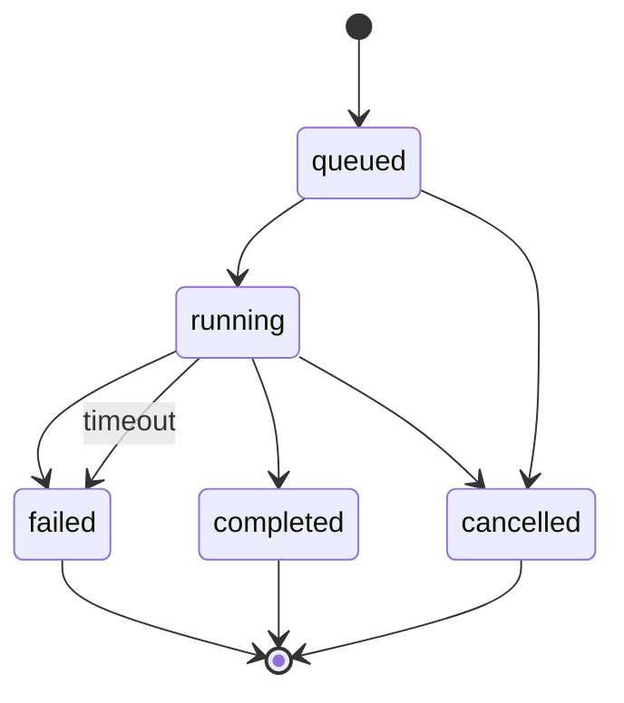

# Architecture

This document describes how Dossier is put together, which invariants it relies on, and where the sharp edges are. It is aimed at someone extending the harness or reviewing the design, not at end users.

## Goals

1. **A real research loop, not a prompt chain.** Each phase has explicit inputs, outputs, and limits.
2. **Evidence you can inspect.** Every claim should be traceable to a numbered source, and the trace should survive export.
3. **Failure should be legible.** Timeouts, cancellations, partial reads, and provider errors are states, not mysterious hangs.
4. **A reusable core.** The web app and CLI are adapters around the same harness.
5. **A small dependency surface.** Raw `fetch`, a custom SSE parser, and a handful of focused libraries instead of an agent framework.

Non-goals: browser automation, paywall bypassing, multi-tenant auth, and distributed orchestration.

## System map

```
apps/web
├── app/api/runs          create / read / cancel
├── app/api/runs/:id/events  SSE replay + live fan-out
├── app/api/runs/:id/trace   persisted event snapshot (JSON)
├── app/harness           developer console: pipeline, adapters, trace
├── lib/run-manager.ts    live runs, seq, cancellation, timeouts
├── lib/store.ts          node:sqlite runs + events, interrupted recovery
├── lib/server-config.ts  runtime singleton, public limits
├── lib/event-labels.ts   event category + human summary for the console
└── components/run/*      event-driven research desk

packages/harness
├── pipeline.ts           scope → discover → read → write → audit
├── runtime.ts            assemble model + search + reader from env
├── providers/            OpenAI-compatible, demo, structured JSON
├── search/               DDG, Tavily, Brave, Serper, Exa, Wikimedia,
│                         Bing News RSS, arXiv, merged fallback
├── reader/               guarded fetch, Readability, PDF, URL safety
├── context.ts            passage scoring, dedupe, token budgeting
├── citations.ts          linkification, sanitization, coverage, ledger
├── audit.ts              deterministic checks + LLM audit merge
├── source-tier.ts        deterministic S/A/B/C source provenance
├── evaluation/           fixture corpus, cases, runner, metrics
└── types.ts              the event and adapter contracts

apps/cli
├── src/index.ts          headless runner with progress on stderr
└── src/eval.ts           benchmark entry, writes evals/latest.json
```

## Run lifecycle



The harness itself is a function, not a daemon. `runResearch(request, options)` emits events through `onEvent` and resolves with a `ResearchResult`. The web app's `RunManager` adds live state, persistence, SSE fan-out, cancellation, and a time budget.

A run is persisted before it starts. Events are appended as `(run_id, seq)` rows. If the process dies mid-run, startup marks any non-terminal row as interrupted; the SSE route can still synthesize a terminal event from the record, so a client never waits forever.

## The event protocol

`HarnessEvent` in [`packages/harness/src/types.ts`](../packages/harness/src/types.ts) is a discriminated union:

```ts
type HarnessEvent =
  | { type: "run.started"; query: string; depth: Depth; model: string; demo: boolean }
  | { type: "phase.started"; phase: Phase; label: string; index: number; total: number }
  | { type: "plan.created"; brief: ResearchBrief }
  | { type: "search.completed"; query: string; count: number; newCount: number; durationMs: number }
  | { type: "source.read"; source: Source }
  | { type: "report.delta"; text: string }
  | { type: "audit.completed"; audit: AuditResult }
  | { type: "run.completed"; stats: RunStats; title: string }
  | ...
```

Design rules:

- **Events are data, not prose.** A UI can render the trace without parsing log lines.
- **Sequences are monotonic per run.** The store assigns `seq`; SSE clients can reconnect with `Last-Event-ID` or `?after=`.
- **Deltas and snapshots coexist.** `report.delta` streams writing progress; `report.snapshot` is available for replay.
- **Terminal states are explicit.** `run.completed`, `run.failed`, `run.cancelled`. The SSE route synthesizes one from the record if live state is gone.
- **Throwing sinks are contained.** A bad listener cannot take down a research run.

## Phase details

### Scope

`createBrief` asks the model for a structured plan (JSON mode with one repair attempt). The plan contains a restatement, audience, 3–5 subquestions, 3–8 queries with kinds (`primary`, `evidence`, `counterpoint`, `recent`), and success criteria.

Normalization:

- The original question is always the first query.
- Duplicate queries are removed.
- If no counterpoint query exists, one is appended when the profile allows it.
- If planning fails for any non-auth reason, a heuristic brief is used instead of failing the run.

### Discover

Each query runs through the configured search provider. The default stack is:

```
DuckDuckGo (no key)
  └─ on failure: Wikipedia + Bing News RSS + arXiv (merged)
```

If a paid provider is configured, it is primary and the free stack runs as a fallback. Results are deduplicated by normalized URL, capped per domain (2 for quick, 3 otherwise), scored with a blend of:

- lexical relevance to the brief,
- search rank,
- domain trust,
- freshness.

After the first round, a coverage assessment (LLM with a heuristic fallback) may request up to two follow-up queries. Follow-ups are skipped when the source cap is reached or the profile allows only one round.

### Read

`PageReader` fetches with a manual redirect loop (max 5). Before every request:

- protocol must be HTTP(S),
- hostname must resolve,
- no private, loopback, link-local, or metadata ranges,
- redirect targets are re-validated.

Content handling:

- HTML / XHTML → Readability; low-content pages fall back to `article`/`main` text.
- PDF (including octet-stream with a PDF signature) → unpdf text extraction.
- Text → clean and truncate.

Article text is reconstructed from block-level HTML rather than raw `textContent`. This prevents captions and byline fragments from being glued into body sentences, and it preserves paragraph boundaries for context packing. Leading metadata lines (dates, reporter lines, image credits, standalone mastheads) are stripped.

Reads are capped per depth profile and run concurrently with a bounded worker pool. A failed read is recorded as `source.failed` and does not fail the run.

### Context

`buildEvidenceContext` splits documents into paragraphs (or sentence-aware chunks for very long paragraphs), scores passages against the brief, deduplicates near-identical passages with Jaccard similarity, and takes at most two passages per source.

The final context is packed into a token budget. Sources are numbered in order of inclusion; those numbers become the citation keys used by the writer. At most ten sources enter the context per run, even at deep depth.

### Write

The writer receives the brief plus the numbered evidence blocks. It streams tokens; the pipeline accumulates deltas and emits `report.delta` events.

After generation:

1. Extract the title.
2. Strip a Markdown code fence if the model wrapped the answer.
3. Linkify `[n]` markers into `cite:` links.
4. Strip citation numbers that have no corresponding source.
5. Compute coverage and source usage.
6. Run the audit; if it requests a revision and the profile allows it, run exactly one revision with the audit feedback.

No second revision. This is deliberate: unbounded revision loops are expensive and usually converge on cosmetic edits.

### Audit

The deterministic layer checks:

- citation coverage (sentences with at least one valid citation),
- number of sources,
- unused or invalid citation numbers,
- unsupported citation patterns (where detectable).

The optional LLM audit returns structured issues, missing angles, and a verdict. The two are merged; the deterministic coverage number wins, while the LLM can add qualitative issues. The audit is a quality signal, not proof.

## Citation model

- Citations are **numbers**, assigned when evidence enters the context.
- The report contains `[n]` markers (or `[n, m]`).
- Numberless or invalid markers are removed before display/export.
- Source records keep `number: number | null`; only cited sources are numbered.
- The web UI renders cite markers as interactive pills; the Markdown export appends a numbered source ledger.
- `citationStats` powers the audit and the UI summary.

This keeps the citation invariant simple: **a number in the report always resolves to a source in the ledger of the same run.**

## Persistence and streaming

`RunStore` uses the built-in `node:sqlite` driver (Node 22.5+), WAL mode, and two tables:

```sql
runs(id, query, depth, language, status, created_at, started_at, finished_at,
     title, report, result_json, error, error_code, stats_json, model, demo,
     source_count, duration_ms)
events(run_id, seq, ts, type, data)
```

`RunManager` keeps live runs in memory, stores every event, and fans it out to SSE subscribers. The SSE route:

1. subscribes before replaying history to avoid a gap,
2. replays events after the requested sequence,
3. closes on a terminal event,
4. sends heartbeats,
5. synthesizes a terminal event from the run record if the process state is gone.

Cancellation aborts the run's controller; the harness unwinds through its abort checks. A run-level timeout uses a separate controller combined with `AbortSignal.any`.

Finished live runs are pruned from memory after 20 minutes; the database records remain.

The `/harness` console is a read-only view over this record. It fetches `GET /api/runs/:id/trace`, renders the typed events with category filters, and exposes each event's raw JSON. It does not have a separate data path: the console, the desk, and SSE clients all read the same persisted sequence.

## Security model

- **SSRF:** DNS resolution plus IP range checks, manual redirects, protocol allowlist. Tests cover localhost, private ranges, link-local, and redirect tricks.
- **Resource limits:** response size caps, fetch timeouts, text truncation, context token budgets, output token caps, per-run time budget.
- **Injection:** page text is treated as data. It is never executed and never concatenated into a system prompt as instructions.
- **Secrets:** keys are read server-side only; error messages pass through redaction before persistence.
- **Abuse:** per-IP creation limits, concurrency cap, request schema validation, and `cache-control: no-store` on run APIs.
- **Headers:** CSP-adjacent hardening (nosniff, frame denial, referrer policy, permissions policy) is set in `next.config.ts`.

Limits are single-process. For multiple instances, replace the in-memory rate limiter and event fan-out with a shared store/pub-sub.

## Failure modes

| Failure                     | Behavior                                                              |
| --------------------------- | --------------------------------------------------------------------- |
| Model auth error            | Run fails immediately with `PROVIDER_AUTH`; no pointless retries.     |
| Model rate limit            | Provider retries with backoff, then fails with `PROVIDER_RATE_LIMIT`. |
| Planner returns bad JSON    | One repair attempt, then heuristic brief.                             |
| All search providers fail   | `NO_SOURCES` with the first provider error.                           |
| Some reads fail             | The run continues with remaining sources; failures are in the trace.  |
| No readable sources         | `NO_SOURCES`; no report is fabricated.                                |
| Writer exceeds token budget | Provider stops; the partial report is surfaced if usable.             |
| Run times out               | Abort with `TIMEOUT`; partial state is persisted.                     |
| Process restarts mid-run    | Startup marks the run interrupted; SSE returns a terminal error.      |
| Browser refresh mid-run     | SSE replays from `Last-Event-ID`; no lost trace.                      |

## Design trade-offs

- **No agent framework.** The loop is small enough to read; typed events and prompt builders are explicit. The cost is that new model/tool abstractions require manual wiring.
- **Source-exported workspace package.** `@dossier/harness` exports TypeScript directly for fast monorepo iteration. Publishing it would require a build step and a browser/server split (the browser-safe entry already exists as `@dossier/harness/browser`).
- **Extractive demo writer.** It makes the app demonstrable without a key and keeps evaluation deterministic. It is intentionally not a model-quality baseline.
- **One revision.** Quality vs. cost. Profiles cap rounds, sources, and tokens; the audit reports issues that are not automatically fixed.
- **Local-first persistence.** SQLite and the filesystem keep the project self-contained. Horizontal scaling is an explicit future step, not an implicit claim.
