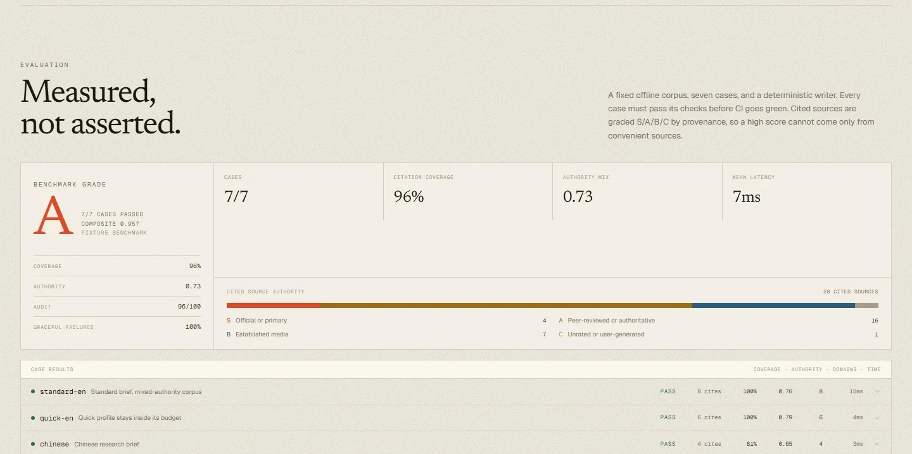
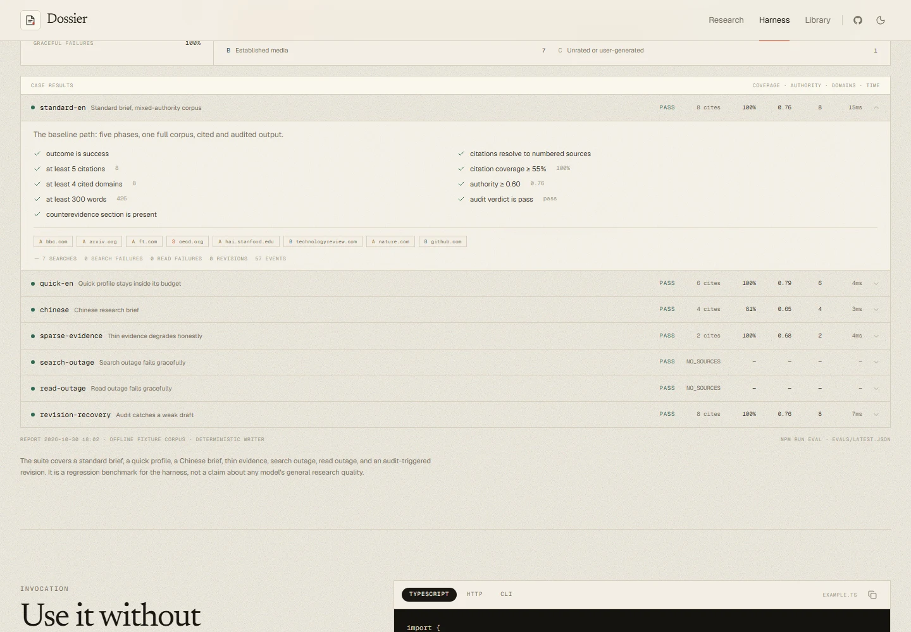

# Evaluation

Dossier ships a deterministic regression benchmark for the research harness:

```bash
npm run eval
```

The command runs seven fixture cases through the real pipeline — scope, discover, read, write, audit — and writes [`evals/latest.json`](../evals/latest.json). The report is rendered in the Evaluation section of `/harness`. A failing case exits with code 1, so CI cannot go green on a regression.

This is **not** a leaderboard score for a language model. It measures whether the harness still produces cited, auditable, honest output under controlled conditions, including provider failures.



## What is fixed

- **Corpus:** documents are bundled with the repo. No network is used.
- **Writer:** the deterministic demo writer, not a hosted model.
- **Inputs:** query, depth, language, and fault injection are defined per case.
- **Outputs:** the report is identical across machines, so metric changes come from code changes.

## Cases

| Case                | Profile  | Setup                               | What it proves                                                     |
| ------------------- | -------- | ----------------------------------- | ------------------------------------------------------------------ |
| `standard-en`       | standard | Mixed S/A/B/C English corpus        | Baseline: five phases, cited brief, passing audit, counterevidence |
| `quick-en`          | quick    | Same corpus, smaller budget         | A cheap profile still produces an auditable brief                  |
| `chinese`           | standard | Chinese query, sources, and report  | The pipeline is not English-only                                   |
| `sparse-evidence`   | standard | Only two fixtures available         | Thin evidence finishes, cites both sources, and the audit objects  |
| `search-outage`     | quick    | Every search throws                 | Typed `NO_SOURCES` failure with recorded `search.failed` events    |
| `read-outage`       | quick    | Every fetch throws                  | Typed `NO_SOURCES` failure with recorded `source.failed` events    |
| `revision-recovery` | standard | First draft is deliberately uncited | Audit triggers exactly one revision; the final draft passes        |



## Metrics

Every case records citations, citation coverage, audit score, cited-domain count, source authority, word count, latency, and token usage. The summary aggregates:

| Metric                | Definition                                                         |
| --------------------- | ------------------------------------------------------------------ |
| Pass rate             | Cases whose named checks all pass                                  |
| Citation coverage     | Share of substantive sentences carrying a resolvable citation      |
| Audit score           | Deterministic + judge audit score for successful cases             |
| Authority score       | Mean S/A/B/C weight of cited sources                               |
| Domain diversity      | Mean number of distinct cited domains                              |
| Graceful failure rate | Failure cases that end in a typed error and a coherent event trace |
| Latency / tokens      | Pipeline overhead and usage in the offline fixture environment     |

The composite is:

```
0.40 × pass rate
+ 0.25 × citation coverage
+ 0.15 × audit score / 100
+ 0.10 × authority score
+ 0.10 × min(domain diversity / 5, 1)
```

Grades: **S** requires composite ≥ 0.90, authority ≥ 0.80, coverage ≥ 0.85, and a 100% pass rate. **A** ≥ 0.80, **B** ≥ 0.70, otherwise **C**. The authority gate is deliberate: a high composite built on weak sources should not earn an S.

## Source authority: S / A / B / C

The suite uses a provenance tiering adapted from enterprise RAG and AI-search source grading. The classifier is in [`packages/harness/src/source-tier.ts`](../packages/harness/src/source-tier.ts) and is deterministic by domain.

| Tier | Meaning                            | Examples                                                | Weight |
| ---- | ---------------------------------- | ------------------------------------------------------- | ------ |
| S    | Official or primary record         | government domains, OECD, UN agencies, standards bodies | 1.00   |
| A    | Peer-reviewed or authoritative     | journals, arXiv, universities, Reuters, FT, Caixin      | 0.80   |
| B    | Established general media          | BBC, MIT Technology Review, 36Kr, GitHub project pages  | 0.55   |
| C    | Unrated, user-generated, or social | Zhihu, Reddit, Medium, personal blogs, unknown domains  | 0.25   |

A domain classification is a prior, not a truth judgment: an official page can still be wrong, and a blog can still be right. That is why the audit and citation checks are separate from the authority mix. Unknown domains default to C rather than being flattered upward.

## Adding a case

1. Add fixture documents (URL, title, domain, date, snippet, text) to `packages/harness/src/evaluation/fixtures.ts`, or reuse the English corpus.
2. Add a case to `packages/harness/src/evaluation/cases.ts` with its expectations and optional fault injection.
3. Run `npm run eval`. The new case appears in the report and on `/harness`.

Expectations are explicit checks, not a single score: minimum citations, coverage, domains, authority, words, audit verdict, language, counterevidence section, revision count, or a typed failure code.

## Limitations

- The deterministic writer makes coverage uniformly high; the suite is a regression signal, not a quality distribution.
- Latency excludes search and model network time, so it measures harness overhead rather than user-perceived speed.
- Domain tiers are coarse. They do not inspect article content, authorship, or funding.
- Fixture documents are fictional but structurally realistic; URLs are never fetched.
- Seven cases are enough to catch regressions, not enough to claim a scientific benchmark. Add cases when a real failure mode appears.

For retrieval-specific ranking quality (NDCG, MRR, recall@k), a search provider should be evaluated separately; this suite measures the artifact the user receives.
